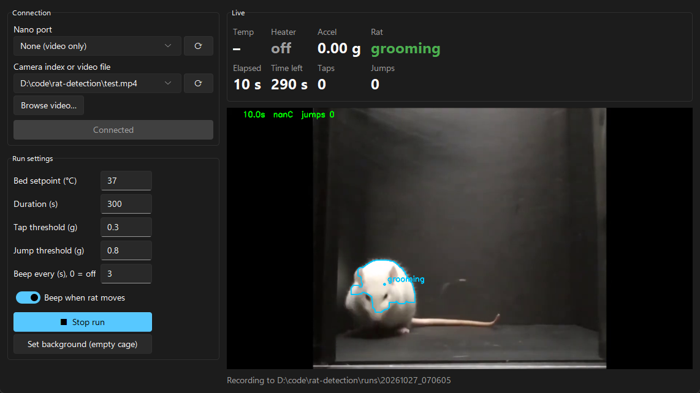

# Rat Heat Bed

A heated test bed for rat behaviour experiments. An Arduino Nano holds the bed at a set temperature and senses taps and jumps through an MPU6050. A Windows app records the rat on camera, tracks where it is and what it's doing, and saves everything to CSV and video.



## What it does

- **Heat control:** the Nano switches an MK2B heat bed through a MOSFET module to hold a setpoint (default 37 °C).
- **Tap and jump detection:** the MPU6050 on the bed reports the biggest shake every 0.1 s. The app counts taps and jumps, beeps, and logs every reading.
- **Rat tracking:** plain OpenCV with no trained model. It finds the rat's position and labels it *moving*, *still*, *rearing* or *grooming*.
- **LCD:** a 16x2 I2C display on the Nano shows the temperature, setpoint, heater state and time left in the run.
- **Two ways to run an experiment:**
  - **Live tracking:** the rat is tracked and labelled on screen during the run.
  - **Record, process after:** during the run you see the video and a live shake graph. After the run, the app makes a processed video with the sensor data drawn on top.

## Hardware

| Part | Connection |
|---|---|
| Arduino Nano (ATmega328P) | USB to the PC |
| DS18B20 temperature sensor | data → D2, 4.7 kΩ pull-up to 5 V. Tape it flat to the centre of the bed. |
| MOSFET module, logic-level, ≥ 15 A (e.g. D4184) | SIG → D9, signal GND → Nano GND. Turns on when D9 is HIGH. |
| MK2B heat bed, 12 V wiring | +12 V → pad 1; pads 2 **and** 3 → module OUT−. Use ≥ 1.5 mm² wire (about 11 A). |
| 12 V power supply, ≥ 15 A | powers the bed through the module |
| MPU6050 (GY-521) | SDA → A4, SCL → A5, VCC → 5 V, GND → GND. Fixed to the bed. |
| 16x2 LCD with I2C backpack | SDA → A4, SCL → A5, VCC → 5 V, GND → GND. Address 0x27 or 0x3F. |
| USB webcam | any; place it side-on or top-down (see [Tuning](#tuning)) |

> **Safety:** the current firmware has **no software cutoff**. The heater keeps following the setpoint even when the PC disconnects or the temperature sensor fails, and there is no maximum-temperature limit. An MK2B at full power can pass 100 °C. Put a normally-closed thermal cutoff (e.g. KSD301, 45–50 °C) in series with the bed and keep it pressed against the bed, especially with an animal on it.

## Setup

### PC (Windows 10/11)

1. Download or clone this repo.
2. Double-click **`install.bat`**. It needs internet the first time.
   - It installs [uv](https://docs.astral.sh/uv/), which downloads its own Python 3.11, so it works whether or not the PC already has Python. It doesn't touch any other Python install.
   - It installs the packages from `requirements.txt` at fixed versions and runs the self-tests.
3. Double-click **`run.bat`** and choose:
   1. **Live tracking**
   2. **Record, process after**
   3. **Watch tracking on a video file** (press Enter to use `test.mp4`)

### Arduino

1. In Arduino IDE's Library Manager, install **OneWire**, **DallasTemperature** and **LiquidCrystal I2C** (Frank de Brabander).
2. Open `firmware/heatbed/heatbed.ino` and choose board **Arduino Nano**. On most clone Nanos, also set Processor to **ATmega328P (Old Bootloader)**.
3. Upload.

If the Nano doesn't show up as a COM port, it probably uses a CH340 USB chip. Windows usually installs the driver by itself; if not, install `CH341SER` from wch-ic.com.

## Using it

### Nano start menu

At power-on, the LCD and Serial Monitor (115200 baud) show a menu for 8 seconds. Type the number and press Enter:

| Key | Mode |
|---|---|
| `1` | **Main program**, used by the app. Starts by itself after 8 s, or as soon as the app connects. |
| `2` | **Heat test without a PC.** Heats to 37 °C. The LCD shows the temperature and the latest shake, so you can tap the bed to test the MPU. |
| `3` | **I2C check.** Tests the SDA/SCL lines and lists what it finds: LCD at 0x27/0x3F, MPU at 0x68. |

### The app

1. **Nano port** finds Arduino boards automatically, including ones plugged in after the app opens. Choose *None (video only)* to test without a Nano.
2. **Camera index or video file** lists the cameras that work. **Browse video…** opens a recorded file instead.
3. Click **Connect**. If your rat isn't a white rat on a dark floor, click **Set background** while the cage is empty.
4. Set the setpoint, duration, tap/jump thresholds and interval beep, then click **Start run**.

Every sound means something different:

| Sound | Meaning |
|---|---|
| short, mid-pitch | rat started moving (at most once per second; switch it off with *Beep when rat moves*) |
| deep, long | interval reached (*Beep every (s)*, 0 = off) |
| very short, high | tap |
| sharp | jump |
| one long beep | run time is up |

### What each run saves

Each run makes a folder `runs/<date_time>/` containing:

| File | Contents |
|---|---|
| `data.csv` | 10 rows per second: time, temperature, setpoint, heater, shake (g), tap/jump flags and counts, rat position and behaviour |
| `frames.csv` | a timestamp for every video frame, used to line the video up with the sensor data |
| `video.mp4` | the recording |
| `background.png` | the empty-cage shot, if you set one |
| `video_processed.mp4` | *record mode only:* the video with the shake graph, TAP!/JUMP! flashes, temperature and tracking drawn on top |
| `tracking.csv`, `summary.txt` | *record mode only:* tracking for every frame, plus totals (taps, jumps, seconds in each behaviour) |

To re-process an old run with different thresholds:

```
.venv\Scripts\python.exe postprocess.py runs\<folder> 0.3 0.8
```

The two numbers are the tap and jump thresholds in g.

## Tuning

| Setting | Where | Notes |
|---|---|---|
| `VIEW` | `rat_track.py` | `"side"` (rearing = the rat gets taller) or `"top"` (rearing = the rat gets smaller) |
| `BRIGHT_THRESH`, `MOVE_FRAC_S`, `REAR_RATIO`, `GROOM_FRAC` | `rat_track.py` | starting values; check them on your own camera with option 3 in `run.bat` |
| Tap / jump threshold | app | set tap just above the normal shake while the rat walks |
| `HYSTERESIS` | `heatbed.ino` | heater turns on below setpoint − H and off above setpoint + H; keep it at 0.3–1 |
| `HEATER_POWER` | `heatbed.ino` | 0–255. Lower it (e.g. 100) if the temperature goes well past the setpoint. |
| `LCD_ADDR` | `heatbed.ino` | 0x27 or 0x3F; menu option 3 shows which one you have |

## Limitations

- Tracking is a brightness/background-difference heuristic, not a pose model. It gives the rat's position and rough behaviour, but not individual paws.
- The MPU tells you *when* a tap happened, not which paw made it. Use the processed video to see the paw.
- A paw model (DeepLabCut SuperAnimal) was tried. It finds the paws roughly but is unreliable without being trained on labelled frames from your own setup.

## Tests

```
.venv\Scripts\python.exe test_rat_track.py
.venv\Scripts\python.exe test_rat_gui.py
.venv\Scripts\python.exe test_postprocess.py
```

`install.bat` runs these automatically.

## Credits

`test.mp4` is from Yakura T, Yokota H, Ohmichi Y, Ohmichi M, Nakano T, Naito M (2018), *Visual recognition of mirror, video-recorded, and still images in rats*, PLOS ONE 13(3): e0194215. [doi:10.1371/journal.pone.0194215](https://doi.org/10.1371/journal.pone.0194215). Licensed under [CC BY 4.0](https://creativecommons.org/licenses/by/4.0/).
